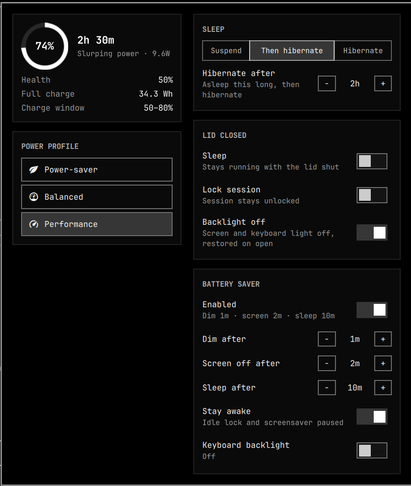

# qpc.power



Omarchy's `omarchy.power` battery widget, extended with lid-close behavior,
stay-awake, keyboard backlight, and battery health. It replaces the stock
battery widget in the bar.

## What it adds

- **Lid closed** section: Suspend, Lock session, Backlight off toggles.
  State lives in `~/.local/state/omarchy/toggles/lid/{suspend,lock,backlight-off}`
  (file present = on). Default: backlight off only, so the laptop keeps
  running, unlocked, with the panel dark.
- **Session** section: Stay awake (wraps `omarchy toggle idle`) and Keyboard
  backlight.
- **Battery health** in the stats grid (`charge_full / charge_full_design`).
- Bar marker next to the battery icon when lid close will suspend or lock.
- Everything from the stock widget: hero, stats, power profile picker,
  right-click to show the percentage.

## Install

```bash
omarchy plugin add https://github.com/quinprobably-netizen/omarchy-power-plugin.git --enable
omarchy plugin disable omarchy.power      # drop the stock battery widget
```

Then wire the lid switch to the plugin. The shell cannot do this for you, and
the panel toggles do nothing until it is done.

1. Tell logind to leave the lid alone (needs root). Without this the laptop
   suspends through logind no matter what the panel says.

   ```bash
   sudo tee /etc/systemd/logind.conf.d/30-ignore-lid-switch.conf >/dev/null <<'CONF'
   [Login]
   HandleLidSwitch=ignore
   HandleLidSwitchExternalPower=ignore
   HandleLidSwitchDocked=ignore
   CONF
   sudo systemctl kill -s HUP systemd-logind
   ```

2. Replace Omarchy's lid bindings and point the Power shortcut at this plugin
   in `~/.config/hypr/bindings.lua`:

   ```lua
   local lid = os.getenv("HOME") .. "/.config/omarchy/plugins/qpc.power/bin/lid-switch"
   hl.unbind("switch:on:Lid Switch")
   hl.unbind("switch:off:Lid Switch")
   o.bind("switch:on:Lid Switch", nil, lid .. " close", { locked = true })
   o.bind("switch:off:Lid Switch", nil, lid .. " open", { locked = true })

   hl.unbind("SUPER + CTRL + P")
   o.bind("SUPER + CTRL + P", "Power", "omarchy-shell shell toggle qpc.power")
   ```

3. `hyprctl reload`, then `omarchy restart shell`.

## Remove

```bash
omarchy plugin remove qpc.power
omarchy plugin enable omarchy.power --section right   # bring the stock widget back
sudo rm /etc/systemd/logind.conf.d/30-ignore-lid-switch.conf && sudo systemctl kill -s HUP systemd-logind
```

Then delete the lid and Super+Ctrl+P lines you added to `~/.config/hypr/bindings.lua`
and run `hyprctl reload`. The flag files under `~/.local/state/omarchy/toggles/lid/`
can be deleted too. Nothing else is written outside the plugin folder.

## How lid close works

Hyprland runs `bin/lid-switch close|open` on the lid switch. On close it reads
the three flags above and, in order: saves brightness and sets the screen and
keyboard backlight to 0, locks the session, runs Omarchy's clamshell display
handler, and suspends. On open it runs the clamshell handler and restores the
saved brightness. Lock and suspend are skipped while an external monitor is
connected, matching stock Omarchy and logind's docked behaviour.

```
bin/lid-switch status            # JSON used by the panel
bin/lid-switch plan              # what `close` would do right now
bin/lid-switch set lock toggle   # same as clicking the panel toggle
bin/power-stats status           # health + keyboard backlight state
```

## Dependencies and privileges

- Omarchy 4.x shell and its commands: `omarchy-hyprland-monitor-clamshell`,
  `omarchy-system-lock`, `omarchy-hw-external-monitors`, `omarchy-toggle-idle`,
  `omarchy-brightness-keyboard`, `omarchy-battery-status`,
  `omarchy-powerprofiles-*`, `omarchy-system-stats`.
- `brightnessctl`, `jq`, `systemctl suspend` (allowed for logged-in users via
  polkit, no password).
- The plugin itself runs as your user and never asks for root. The only root
  step is the one-time logind drop-in in the install instructions.

## Notes

- Omarchy's menu entry "Battery Percentage" targets the stock widget's IPC and
  will not affect this one. Right-click the bar icon instead.
- The plugin id stays `qpc.power` so the lid script path is stable.

## Editing

Saving files here triggers a plugin reload, but the IPC-opened panel kept
serving the previous instance in practice. After editing `Panel.qml`, run
`omarchy restart shell` to be sure the new version is live.

## License

MIT. `Panel.qml` and `Model.js` derive from Omarchy's `omarchy.power` widget,
also MIT.

## Panel controls (2026-10-29 redesign)

Two-column panel. Left: battery card (ring gauge, time left or to full, draw,
health, full-charge energy, firmware charge window) and the power profile.
Right: Sleep, Lid closed and Battery saver cards.

| Control | Writes through |
|---|---|
| Sleep action (Suspend / Then hibernate / Hibernate) | `battery-saver set SLEEP_ACTION …` (qpc.battery-saver) |
| Hibernate after | `pkexec /usr/local/bin/battery-saver-sys set-hibernate-delay …` (password-free for wheel once `50-battery-saver.rules` from the battery-saver plugin is installed in `/etc/polkit-1/rules.d`; otherwise a polkit dialog appears) |
| Lid closed: Sleep / Lock session / Backlight off | `bin/lid-switch set …` |
| Battery saver: Enabled | `omarchy-shell battery-saver enable|disable` |
| Dim / Screen off / Sleep after | `battery-saver set IDLE_*_SECONDS …` |
| Stay awake, Keyboard backlight | unchanged (`omarchy-toggle-idle`, `bin/power-stats kbd toggle`) |

Without the qpc.battery-saver plugin the Sleep and Battery saver cards are
hidden and a Session card holds the last two switches. Components live in
`Card.qml`, `RingGauge.qml`, `SegmentedControl.qml` and `Stepper.qml`.
